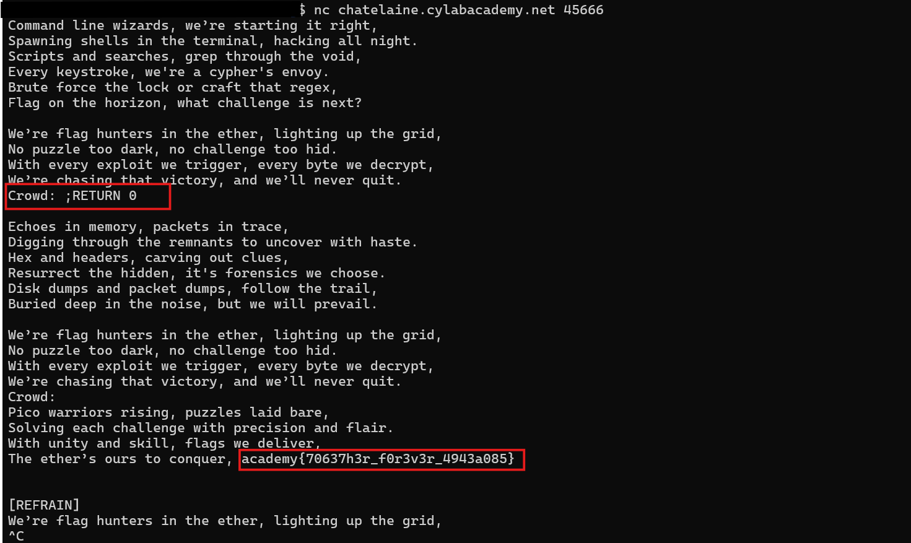

# Method

1. The flag is stored at the beginning of the song in `secret_intro`.
2. The program starts reading from `[VERSE1]`, skipping the intro where the flag is located.
3. The program asks for input when it reaches `CROWD`.
4. The input is added to the current song line using `song_lines[lip] = 'Crowd: ' + crowd`.
5. The program splits each song line at semicolons using `.split(';')`.
6. The `RETURN` command changes `lip`, which controls the current line index.

## Code Analysis

The program stores the user's input in the current song line:

```python
song_lines[lip] = 'Crowd: ' + crowd
```

It splits the line at semicolons:

```python
for line in song_lines[lip].split(';'):
```

It also handles `RETURN` commands:

```python
elif re.match(r"RETURN [0-9]+", line):
    lip = int(line.split()[1])
```

The number after `RETURN` becomes the new line index. For example, `RETURN 0` jumps to the beginning of the song.

## Evidence


