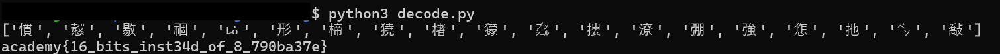

# Method

The challenge provided this code:

```python
''.join([chr((ord(flag[i]) << 8) + ord(flag[i + 1])) for i in range(0, len(flag), 2)])
```

This code combines every two characters into one Unicode character.

- `ord()` converts a character into its numeric code.
- `<< 8` shifts the first character's code 8 bits to the left.
- `+` adds the second character's code.
- `chr()` converts the combined number into a Unicode character.
- `''.join()` combines all the resulting characters into one string.

## Decoding

To reverse the encoding, the `enc` file is read and each Unicode character is split into its two original characters.

- `ord(c)` converts each Unicode character into its numeric code point.
- `n >> 8` extracts the first character's code.
- `n & 0xFF` extracts the second character's code from the lowest 8 bits.
- `chr()` converts both values back into characters.
- `''.join(decoded)` combines the recovered characters to reveal the original text and flag.

## Evidence

