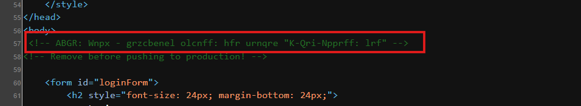
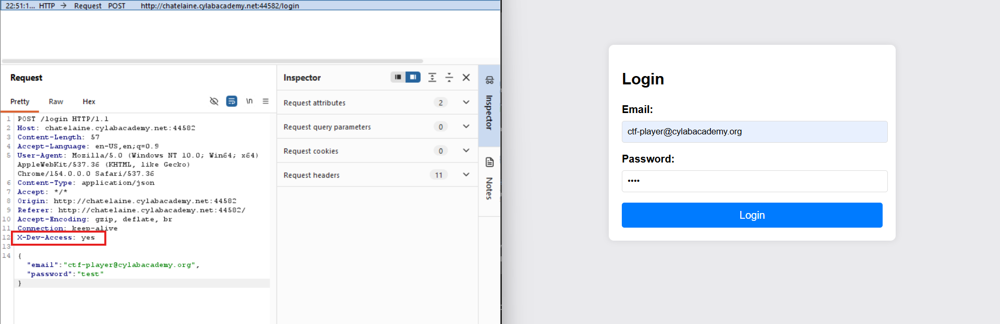
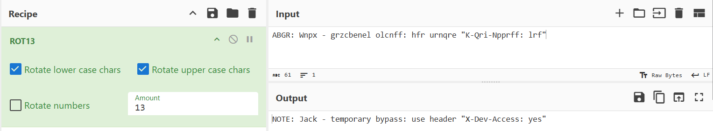
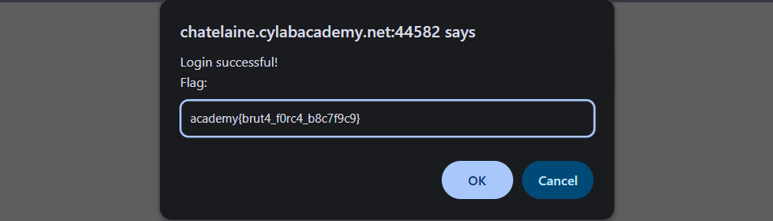

## Method

1. Inspected the page source and found a suspicious HTML comment.
2. Suspected the text was encoded because it resembled transformed natural language.
3. Used CyberChef's ROT13 operation to decode the comment.
4. Identified the suggested HTTP header: `X-Dev-Access: yes`.

### What is ROT13?

ROT13 is a substitution cipher that shifts each letter 13 positions through the alphabet. Applying it twice restores the original text. It is obfuscation, not secure encryption.

Example

`Unpxvat vf sha` → `Hacking is fun`

Each letter is shifted 13 positions. For example, `U` becomes `H` and `n` becomes `a`.

## Evidence

**Found the suspicious comment in the page source**

**Inspected the ROT13-encoded text**

**Used CyberChef to decode the comment and reveal the suggested HTTP header**

**Flag captured**

## Key Takeaway

- HTML comments are visible to clients and can expose sensitive implementation details.
- ROT13 can obfuscate text, but it does not provide security because it is easy to reverse.
- Source code can reveal clues about hidden functionality and potential access-control weaknesses.
- Access-control bypasses should be verified by testing whether a request actually grants unauthorized access.