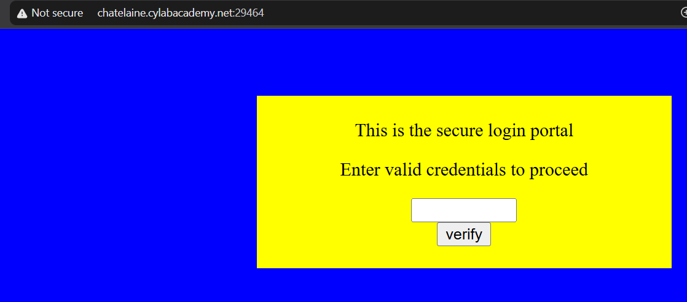
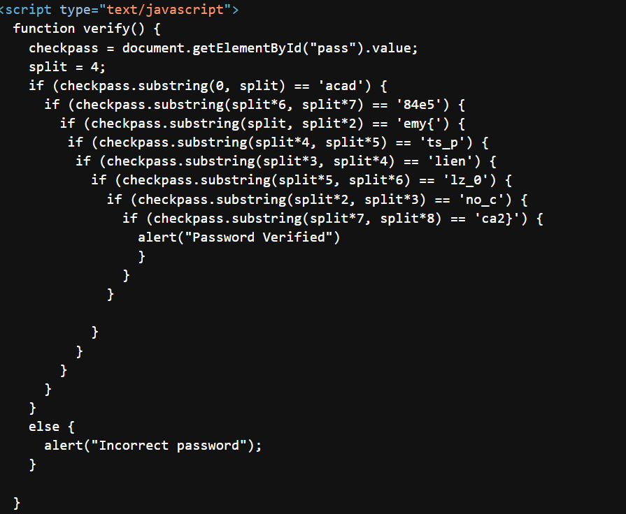

# Method

1. Inspect the page source.
2. Locate and inspect the inline JavaScript containing the password verification logic.
3. Analyze the substring checks and rearrange the four-character chunks to reconstruct the flag.
4. Verify the reconstructed flag using the original substring conditions.

## Evidence

## Takeaway

The password verification logic was embedded directly in the HTML source, exposing the substring checks used to validate the password. Analyzing these checks made it possible to reconstruct the flag. This demonstrates why client-side validation should not be relied on to protect sensitive information.
