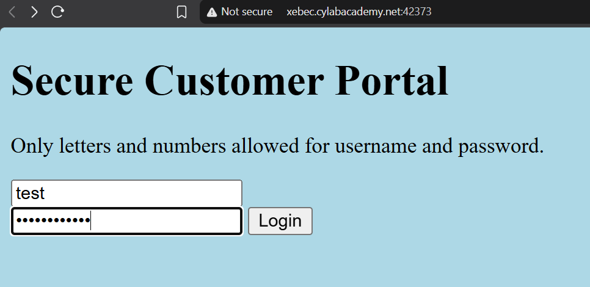
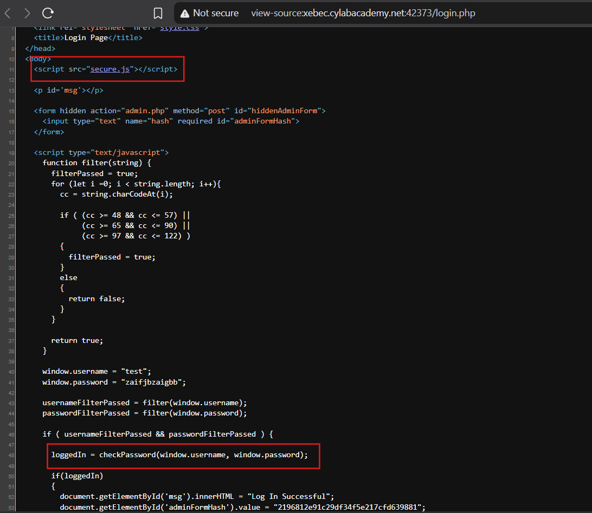
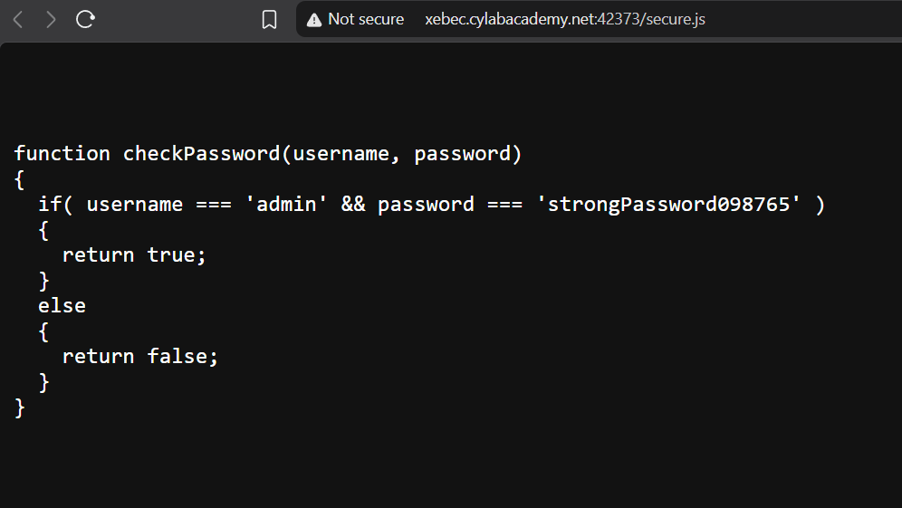
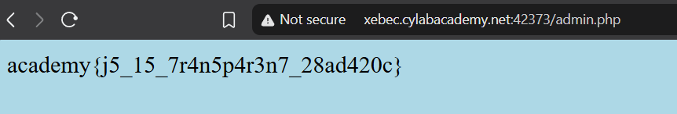

# Method

1. Log in with random credentials.
2. This takes us to `login.php`.
3. Inspect `login.php`.
4. Find a JavaScript source file, `secure.js`, responsible for validating credentials.
5. Inspect it and find the admin credentials.

## Evidence

## Takeaway

The login mechanism exposes sensitive information in client-side JavaScript, including hardcoded credentials and an admin hash. Since JavaScript sent to the browser can be inspected by users, authentication logic and secrets must not be stored on the client side. Authentication and authorization should be enforced server-side.
